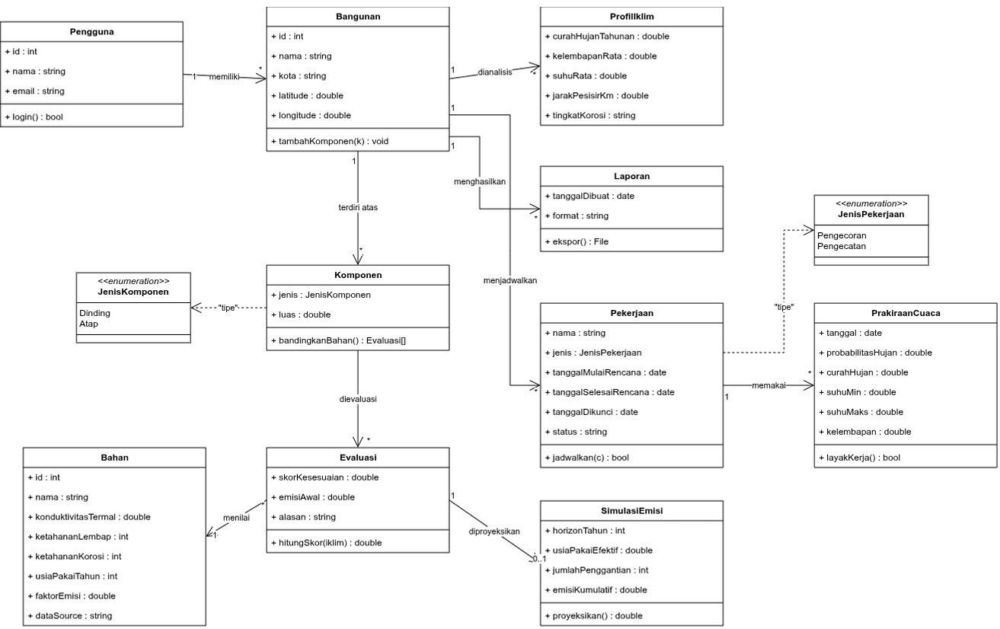

# Wastu

**Pembanding bahan bangunan berbasis iklim dan jejak karbon untuk pemilik rumah.**

Wastu adalah aplikasi desktop yang membantu calon pemilik rumah memilih bahan dinding dan atap yang
cocok dengan iklim lokasi bangunan sekaligus memperhitungkan jejak karbon tersemat tiap bahan, lalu
menjadwalkan pekerjaan konstruksi sesuai prakiraan cuaca.

Kelompok Manut

Ketua Kelompok: Dien Muhammad Scientivan Kurniapramono - 24/533571/TK/59114  \
Anggota 1: Yohanes Anthony Saputra - 24/536327/TK/59524 \
Anggota 2: Ramzi Alfito Rizky - 24/540550/TK/60008

## Class Diagram: 

## Latar belakang

Pemilihan bahan bangunan rumah tinggal di Indonesia umumnya ditentukan oleh harga dan kebiasaan tukang,
bukan oleh kecocokan bahan dengan curah hujan, kelembapan, suhu, dan risiko korosi di lokasi bangunan.
Akibatnya bahan cepat rusak, penggantian dini lebih sering terjadi, dan setiap penggantian mengulang emisi
karbon produksi bahan. Pengecoran atau pengecatan pada cuaca yang salah juga berujung pada pengerjaan ulang.

Wastu menjawab masalah itu dengan tiga prinsip:

1. **Iklim dan karbon dinilai berdampingan.** Skor kesesuaian iklim dan emisi (kgCO₂e) tampil pada satu
   peringkat yang sama, lengkap dengan alasan tertulis yang mudah dipahami.
2. **Emisi dihitung sebagai konsekuensi jangka panjang.** Bahan yang kurang cocok dengan iklim diberi usia
   pakai efektif lebih pendek, sehingga simulasi menangkap emisi berulang akibat penggantian dini.
3. **Penjadwalan kerja menyatu dengan rekomendasi bahan.** Hari layak kerja untuk pengecoran dan
   pengecatan dinilai dari prakiraan cuaca lokasi proyek.

## Fitur

- **Profil proyek** — nama, kota atau koordinat lokasi, jarak ke pesisir, serta luas dinding dan atap.
  Pengguna dapat mengelola lebih dari satu proyek.
- **Analisis iklim lokasi** — curah hujan tahunan, kelembapan, dan suhu rata-rata dari data historis
  Open-Meteo.
- **Eksplor material** — katalog bahan dinding dan atap dengan skor kesesuaian iklim, status kecocokan,
  dan emisi awal untuk luas bidang proyek.
- **Bandingkan material** — dua bahan berdampingan beserta peringkat kesesuaian seluruh bahan sejenis.
- **Simulasi emisi** — proyeksi emisi kumulatif 20, 30, atau 50 tahun termasuk jumlah penggantian bahan.
- **Jadwal pekerjaan** — prakiraan cuaca 14 hari, penilaian hari layak atau tidak layak untuk pengecoran
  dan pengecatan, serta penguncian tanggal pekerjaan.
- **Laporan proyek** — ringkasan proyek, profil iklim, peringkat material, simulasi emisi, dan jadwal
  terkunci yang dapat disimpan sebagai PDF untuk dibawa ke tukang atau kontraktor.

## Alur penggunaan

1. Buat proyek baru: beri nama, tentukan lokasi, lalu isi luas dinding dan atap.
2. Perbarui profil iklim lokasi dan tinjau ringkasan proyek di Beranda.
3. Telusuri katalog bahan, pilih dua bahan, lalu bandingkan kesesuaian dan emisinya.
4. Simulasikan emisi jangka panjang untuk melihat dampak penggantian dini.
5. Ambil prakiraan cuaca, pilih hari yang layak, dan kunci jadwal pekerjaan.
6. Simpan laporan rekomendasi sebagai PDF.

## Teknologi

Aplikasi desktop Windows berbasis WPF (.NET 8, C#) dengan data cuaca dan iklim dari Open-Meteo.

## Batasan

Properti bahan, faktor emisi, dan profil iklim bawaan masih berupa estimasi awal dari referensi literatur
publik, belum dikalibrasi untuk produk di pasar lokal Indonesia. Usia pakai efektif dan simulasi emisi
adalah estimasi untuk membantu keputusan, bukan jaminan.
