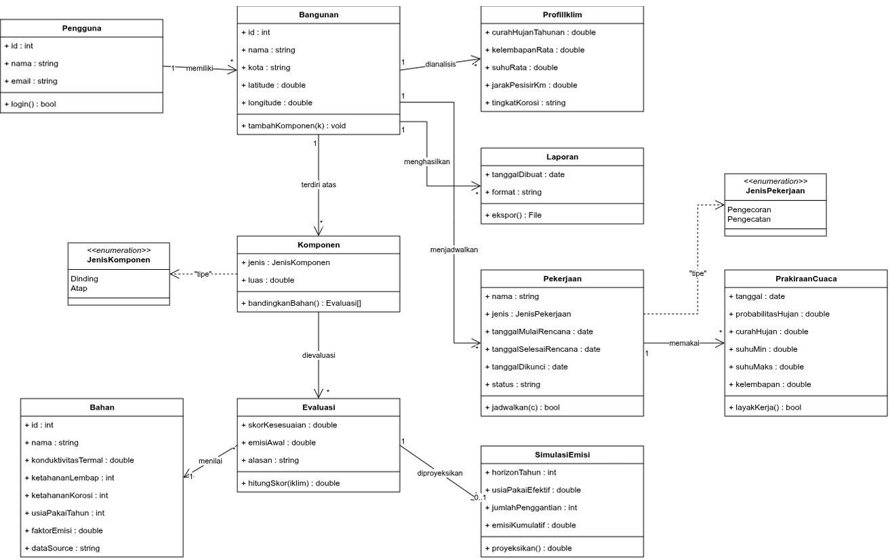

# Wastu

**Pembanding bahan bangunan berbasis iklim dan jejak karbon untuk pemilik rumah.**

Wastu adalah aplikasi desktop yang membantu calon pemilik rumah memilih bahan dinding dan atap yang
cocok dengan iklim lokasi bangunan sekaligus memperhitungkan jejak karbon tersemat tiap bahan, lalu
menjadwalkan pekerjaan konstruksi sesuai prakiraan cuaca.

### Kelompok Manut

- **Ketua Kelompok:** Dien Muhammad Scientivan Kurniapramono — 24/533571/TK/59114
- **Anggota 1:** Yohanes Anthony Saputra — 24/536327/TK/59524
- **Anggota 2:** Ramzi Alfito Rizky — 24/540550/TK/60008

## Diagram Kelas

> [!NOTE]
> Diagram di bawah adalah **diagram kelas historis tugas awal Modul 3** dan dipertahankan sebagai arsip historis. Spesifikasi UML normatif sistem didefinisikan secara resmi pada [docs/uml-wastu.md](docs/uml-wastu.md) dan sumber visual [docs/uml-wastu.drawio](docs/uml-wastu.drawio), dengan penjelasan pemetaan C# pada [docs/implementasi-class-diagram.md](docs/implementasi-class-diagram.md).

## Latar Belakang

Pemilihan bahan bangunan rumah tinggal di Indonesia umumnya ditentukan oleh harga dan kebiasaan tukang,
bukan oleh kecocokan bahan dengan curah hujan, kelembapan, suhu, dan risiko korosi di lokasi bangunan.
Akibatnya bahan cepat rusak, penggantian dini lebih sering terjadi, dan setiap penggantian mengulang emisi
karbon produksi bahan. Pengecoran atau pengecatan pada cuaca yang salah juga berujung pada pengerjaan ulang.

Wastu menjawab masalah itu dengan tiga prinsip:

1. **Iklim dan karbon dinilai berdampingan.** Skor kesesuaian iklim dan emisi (kgCO₂e) tampil pada satu
   peringkat yang sama, lengkap dengan alasan tertulis yang mudah dipahami.
2. **Emisi dihitung sebagai konsekuensi jangka panjang.** Bahan yang kurang cocok dengan iklim diberi usia
   pakai efektif lebih pendek, sehingga simulasi menangkap emisi berulang akibat penggantian dini.
3. **Penjadwalan kerja menyatu dengan rekomendasi bahan.** Hari layak kerja untuk pengecoran dan
   pengecatan dinilai dari prakiraan cuaca lokasi proyek.

## Status Sistem: Baseline Saat Ini vs Target Revisi Spesifikasi

Tabel berikut membedakan kapabilitas yang tersedia pada implementasi *baseline* saat ini dari target spesifikasi revisi normatif (WP00–WP08):

| Modul / Aspek | Kapabilitas Baseline Saat Ini | Target Revisi Spesifikasi (PRD-R01 — PRD-R11) |
|---|---|---|
| **Profil Proyek (F1)** | Constructor `Domain.Komponen` sudah memvalidasi luas $> 0$ (menolak non-finite dan $\le 0$), namun antarmuka dan kebijakan pembuatan proyek saat ini mewajibkan input luas dinding serta atap sekaligus. Bounding box bujur 94°–142° BT. | [TARGET] Mendukung fleksibilitas komponen: dinding saja, atap saja, atau keduanya (luas $> 0\text{ m}^2$) tanpa regresi init/with. Bounding box diseragamkan ke rentang inklusif lintang $[-11, 6]$ dan bujur $[95, 141]$ dengan migrasi aman untuk data legacy (§PRD-R07). |
| **Katalog Bahan (F2)** | Seed 15 bahan dinding dan 10 bahan atap tersimpan di database/JSON, namun terdapat divergensi nilai dan properti antara katalog lokal (`Services/Katalog.cs`) dan seed PostgreSQL (`database/03_seed_supabase.sql`); detail properti belum menampilkan seluruh rincian sumber. | [TARGET] Harmonisasi dataset kanonik lintas-mode (lokal dan PostgreSQL); faktor emisi wajib dinormalisasi ke $\text{kgCO}_2\text{e/m}^2$ untuk susunan/ketebalan tertentu; pencatatan sumber per properti + status perkiraan/terverifikasi; klasifikasi provenance data (§PRD-R03, §PRD-R09). |
| **Analisis Iklim (F3)** | Klien Open-Meteo historis 10 tahun dan estimasi jarak pesisir garis pantai Natural Earth 1:10m. Profil tersimpan per proyek. | [TARGET] Pengambilan iklim otomatis saat online; penanganan kegagalan graceful dengan penanda profil iklim 0..1; pemisahan provenance iklim (`ApiHistoris`, `EstimasiBawaan`, `CacheHistoris`, `LegacyUnknown`) (§PRD-R09, §PRD-R10). |
| **Perbandingan & Bobot (F4)** | Peringkat bahan dengan 4 kriteria berbobot default 0,25. Rumus lembap lama cepat jenuh pada curah hujan sedang. Ambang UI memakai 55 sedangkan domain 50. | [TARGET] Rumus lembap baru dengan $\alpha=0{,}5$ dan acuan 3000 mm/thn yang sensitif terhadap variasi hujan (§PRD-R04). Ambang label terpusat: $<55$ *Tidak disarankan*, $55..74,999$ *Perlu pertimbangan*, $\ge 75$ *Cocok*. Mode MVP mengunci bobot pada 0,25; mode V2 menyediakan bobot kustom tervalidasi ($\sum=100\%$) dan reset (§PRD-R01, §PRD-R10). |
| **Simulasi Emisi (F5)** | Kode domain sudah mengadopsi $\lceil H/L \rceil - 1$, namun narasi PRD lama masih mencantumkan `floor(H/L)` dan UI memiliki duplikasi dengan epsilon terpisah. Hasil disimpan per `EvaluasiId` saja. | [TARGET] Menyatukan seluruh dokumen, domain, UI, dan grafik emisi kumulatif pada satu kontrak konsisten strictly $0 < t < H$: $n = \max(0, \lceil H/L \rceil - 1)$ (§PRD-R02). Kasus acuan: nominal 15 thn, skor 20, $H=30 \rightarrow L=9$ thn, 3 penggantian (thn 9, 18, 27), total emisi $\times 4$. Riwayat multi-horizon disimpan simultan (relasi 0..*, §PRD-R10). |
| **Penjadwal Cuaca (F6)** | Mengambil prakiraan 14 hari Open-Meteo; evaluasi ambang pengecoran dan pengecatan generik; jadwal disimpan di JSON lokal; penguncian hari berisiko didukung. | [TARGET] Mendukung override spesifikasi produk bahan terpilih (§PRD-R05). Status evaluasi multi-nilai: `Layak`, `Waspada` (suhu pengecoran >35°C), `TidakLayak` (alasan spesifik), dan `DataTidakTersedia`. Cache ber-TTL 6 jam UTC dengan penafsiran tanggal menurut zona waktu lokasi proyek (§PRD-R08). |
| **Ekspor Laporan (F7)** | Tombol PDF menjalankan `PrintDialog` Windows; `Models/Laporan.Ekspor` hanya menulis teks sederhana. | [TARGET] Generator PDF mandiri berlisensi sesuai, memuat profil proyek, iklim, bahan terpilih, simulasi horizon, dan jadwal terkunci lengkap dengan catatan transparansi sumber dan peninjauan riwayat lokal luring (§PRD-R06). |
| **Persistensi & Luring** | Mendukung PostgreSQL (lokal/remote Supabase) dan mode JSON lokal (`state.json` / `state-postgres.json`). Gagal koneksi remote saat startup menutup aplikasi. | [TARGET] PostgreSQL sebagai penyimpanan utama relasional; snapshot lokal atomik read-only untuk koneksi remote saat offline sehingga aplikasi tetap dapat dibuka untuk ditinjau tanpa crash (§PRD-R06). |

## Fitur Aplikasi

- **Profil Proyek:** Nama, kota atau koordinat lokasi, jarak ke pesisir, serta luas dinding dan atap. Pengguna dapat mengelola lebih dari satu proyek. *(Target revisi: mendukung proyek dinding saja atau atap saja).*
- **Analisis Iklim Lokasi:** Curah hujan tahunan, kelembapan, dan suhu rata-rata dari data historis 10 tahun Open-Meteo.
- **Eksplor Material:** Katalog bahan dinding dan atap dengan skor kesesuaian iklim, status kecocokan, dan emisi awal untuk luas bidang proyek.
- **Bandingkan Material:** Dua bahan berdampingan beserta peringkat kesesuaian seluruh bahan sejenis.
- **Simulasi Emisi:** Proyeksi emisi kumulatif 20, 30, atau 50 tahun termasuk jumlah penggantian bahan.
- **Jadwal Pekerjaan:** Prakiraan cuaca 14 hari, penilaian hari layak atau tidak layak untuk pengecoran dan pengecatan, serta penguncian tanggal pekerjaan.
- **Laporan Proyek:** Ringkasan proyek, profil iklim, peringkat material, simulasi emisi, dan jadwal terkunci untuk dibawa ke tukang atau kontraktor. *(Target revisi: generator PDF mandiri dengan riwayat).*

## Alur Penggunaan

1. **Buat Proyek Baru:** Beri nama, tentukan lokasi (pilih kota atau koordinat), lalu isi luas dinding dan atap. *(Target revisi: dapat memilih salah satu komponen saja).*
2. **Perbarui Profil Iklim:** Tinjau ringkasan iklim lokasi di Beranda.
3. **Bandingkan Bahan:** Telusuri katalog bahan, pilih dua bahan, lalu bandingkan kesesuaian dan emisinya.
4. **Simulasikan Emisi:** Lihat dampak penggantian dini material sepanjang masa pakai rumah.
5. **Jadwalkan Pekerjaan:** Ambil prakiraan cuaca, pilih hari yang layak, dan kunci jadwal pekerjaan.
6. **Simpan Laporan Rekomendasi:** Ekspor laporan sebagai PDF.

## Teknologi

Aplikasi desktop Windows berbasis WPF (.NET 8, C#) dengan data cuaca dan iklim dari Open-Meteo.

## Menjalankan dengan PostgreSQL

1. Buat database lokal dengan `database/01_create_database.sql` atau gunakan database PostgreSQL yang sudah tersedia.
2. Jalankan `database/02_schema.sql` dan `database/03_seed_supabase.sql` pada database tersebut.
3. Isi `.env` sesuai `.env.example` dengan `host`, `port`, `database`, `user`, dan `password` dari Supabase. Aplikasi menyusun connection string Npgsql otomatis dengan SSL. Gunakan session pooler port 5432. Alternatifnya, isi `WASTU_CONNECTION_STRING` lengkap untuk mengesampingkan variabel terpisah.

4. Jalankan `dotnet run --project Wastu.csproj` di Windows dengan .NET 8 SDK. Uji backend dapat dijalankan dengan `dotnet test Wastu.sln`.

File `.env` dicari dari direktori kerja, lalu direktori executable, termasuk folder induknya. Environment variable yang terisi lebih diutamakan daripada nilai dalam file. `.env` tidak disertakan dalam build atau publish dan tidak boleh di-commit. Untuk menjalankan hasil publish, sediakan `.env` sendiri di direktori executable atau atur environment variable. Konfigurasi database yang hanya terisi sebagian akan menghasilkan kesalahan agar aplikasi tidak diam-diam beralih ke mode lokal.

Dengan koneksi PostgreSQL, proyek, luas bidang, profil iklim, dan katalog dibaca dari database. Katalog dimuat saat aplikasi dibuka. Jadwal dan preferensi tampilan disimpan di `state-postgres.json`. Saat seluruh konfigurasi koneksi kosong, aplikasi membuka proyek dan katalog lokal seperti biasa. Proyek lama tetap dapat dibuka di mode lokal melalui `state.json`.

Dalam mode PostgreSQL, profil iklim memakai 10 tahun data historis Open-Meteo. Jarak pesisir diestimasi dari segmen garis pantai regional [Natural Earth 1:10m](https://www.naturalearthdata.com/downloads/10m-physical-vectors/10m-coastline/). Resolusi garis pantai membatasi akurasi jarak pada pulau kecil.

## Batasan dan Transparansi

Properti bahan, faktor emisi, dan profil iklim bawaan masih berupa estimasi awal dari referensi literatur publik, belum dikalibrasi untuk produk spesifik di pasar lokal Indonesia. Saat ini terdapat divergensi nilai dan properti antara katalog lokal (`Services/Katalog.cs`) dan seed PostgreSQL (`database/03_seed_supabase.sql`); target revisi spesifikasi menyatukan keduanya ke dalam satu dataset kanonik lintas-mode. Usia pakai efektif dan simulasi emisi adalah model perhitungan estimasi matematis untuk membantu keputusan, bukan jaminan keawetan mutlak di lapangan.
