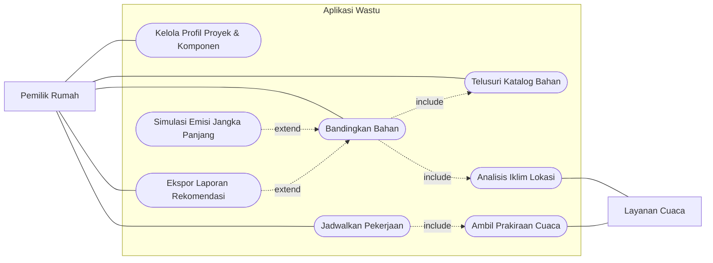
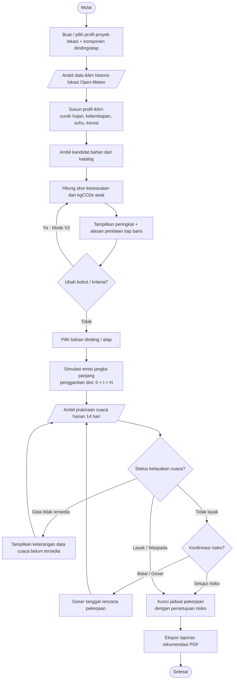
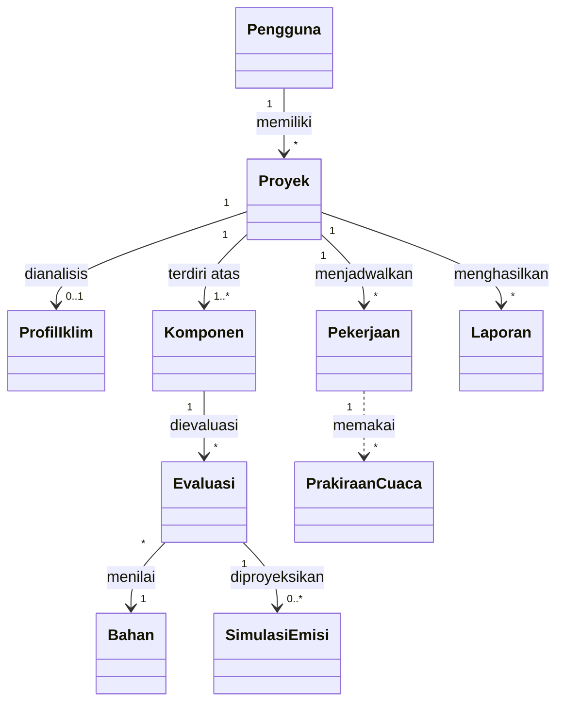
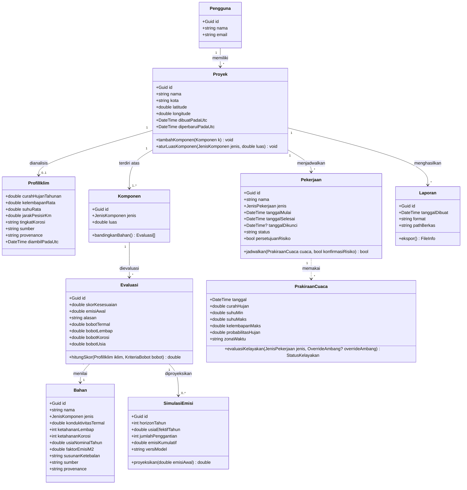

# Diagram UML — Wastu

Sumber diagram (Mermaid) untuk aplikasi **Wastu**: pemilihan bahan bangunan berbasis kesesuaian iklim lokasi dan jejak karbon tersemat. Cakupan versi target (hingga V2): komponen **dinding** dan **atap** (fleksibel: dinding saja, atap saja, atau keduanya).

Diagram ini merupakan spesifikasi UML normatif Wastu yang telah diselaraskan dengan PRD-R01 sampai PRD-R11 (§PRD-R10).

---

## 1. Use Case Diagram

Aktor:
- **Pemilik Rumah** (aktor manusia utama): calon pemilik rumah atau pemilik rumah yang merenovasi.
- **Layanan Cuaca** (aktor sistem eksternal): penyedia API cuaca pihak ketiga (Open-Meteo) yang melayani data historis iklim 10 tahun dan data prakiraan harian 14 hari.

Aplikasi bersifat desktop *single-user*, sehingga tidak memerlukan use case autentikasi/login pengguna.

---

## 2. Activity Diagram

Alur utama: mulai dari pembuatan profil proyek, analisis iklim, perbandingan berperingkat, kustomisasi bobot (V2), simulasi emisi multi-horizon, penjadwalan cuaca dengan penanganan risiko, hingga ekspor laporan rekomendasi PDF.

Pengubahan kriteria/bobot mengarahkan alur kembali langsung ke penghitungan skor kesesuaian tanpa membuat proyek baru (§PRD-R01, §PRD-R10).

---

## 3. Domain Model

Entitas inti dan relasi domain Wastu. Diagram ini mencerminkan struktur domain logis setelah koreksi PRD-R10:
- `Proyek` memiliki relasi `0..1` ke `ProfilIklim` (profil iklim bernilai null sebelum berhasil diambil dari API atau saat koordinat baru belum selesai dianalisis).
- `Proyek` memiliki minimal satu `Komponen` (`1..*`), mendukung evaluasi dinding saja, atap saja, atau keduanya.
- `Evaluasi` memiliki relasi `0..*` ke `SimulasiEmisi` (evaluasi awal/draft boleh belum memiliki hasil simulasi emisi, dan setelah dieksekusi dapat menyimpan hasil proyeksi untuk berbagai horizon waktu 20, 30, dan 50 tahun secara bersamaan).
- Entitas `Pengguna` tidak lagi memiliki operasi `login()` karena aplikasi beroperasi secara *single-user desktop*.

---

## 4. Class Diagram

Class diagram normatif lengkap dengan atribut dan operasi yang telah diselaraskan dengan kontrak C#/.NET 8 dan skema database relasional:

---

## 5. Hubungan dengan Diagram Historis

Berkas gambar diagram kelas historis [`docs/class-diagram.png`](class-diagram.png) berasal dari tugas awal Modul 3 dan dipertahankan semata-mata sebagai catatan arsip historis. Diagram normatif yang mengikat implementasi dan pengujian adalah diagram Mermaid di atas dan berkas sumber [`docs/uml-wastu.drawio`](uml-wastu.drawio).
